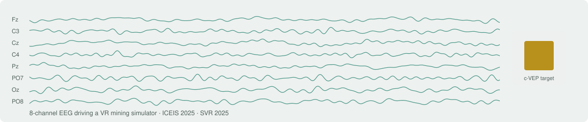
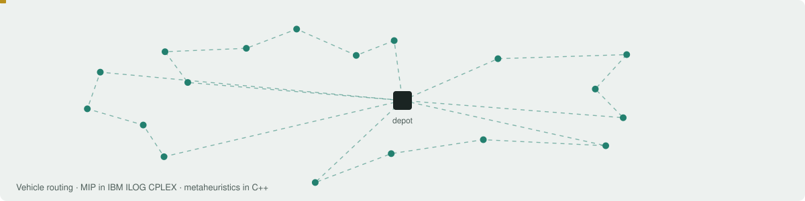

  <a href="https://joao-jardim.github.io"><b>🌐 Portfolio</b></a> &nbsp;·&nbsp;
  <a href="mailto:victorjoaojardim@gmail.com"><b>✉️ Email</b></a> &nbsp;·&nbsp;
  <a href="#-em-português"><b>🇧🇷 Português</b></a>

I'm a Computer Science student at **UFOP** (Brazil), graduating Dec 2027. I turn real-world problems — classrooms, ore piles, delivery routes — into models a computer can solve, and I like building the software around them. The banner above is literally that: a simulated annealing run looking for the lowest point of a cost surface.

---

### 🔬 Research

**VR + brain–computer interface for the mining industry** · XR4GOOD Lab, UFOP · 2024–2025 (PIBITI grant) 
A VR simulator of ore-wagon loading in Unity/C#, controlled through an 8-channel EEG with code-modulated visual evoked potentials (the flickering square above). Tested with 26 participants: usability (SUS) of 77, above the 68 threshold.

- *Towards a VR-BCI Based System to Evaluate the Effectiveness of Immersive Technologies in Industry* — **ICEIS 2025** · [doi](https://doi.org/10.5220/0013483800003929)
- *Would You Mind? Evaluating User Acceptance and Usability of a Brain-Interface System in an Industrial Scenario* — **SVR 2025** · [doi](https://doi.org/10.1109/SVR67689.2025.00046)

**Optimization for classroom allocation** · GOAL Lab, UFOP · 2025–2026 (my thesis) 
Real institutional data, a mathematical model, and C++ metaheuristics that weigh capacity, preferences and scheduling constraints.

---

### 🚚 Optimization & operations research

| Project | What it does | Stack |
|---|---|---|
| [**Fleet routing**](https://github.com/joao-jardim/TP_otimizacao) | Mixed-integer model minimizing makespan, with subtour elimination, flow conservation and truck–forklift synchronization | C++ · IBM ILOG CPLEX |
| [**Ore blending**](https://github.com/joao-jardim/cplex_cpp) | Linear programs for minimum-cost ore mixing under iron, silica and alumina targets, with relaxed and goal-programming variants | C++ · CPLEX |
| [**Room allocation metaheuristics**](https://github.com/joao-jardim/tp-metaheuristicas) | Greedy/RCL construction, hill climbing over 5 neighbourhoods, hybrid simulated annealing with convergence logs | C++17 · Python |
| [**Two-constraint 0-1 knapsack**](https://github.com/joao-jardim/problema-da-mochila) | Backtracking vs. branch and bound vs. 3D dynamic programming, automated benchmark + Friedman test | C++ · pandas · SciPy |
| [**Genetic algorithm for the CVRP**](https://github.com/joao-jardim/tp_comp.evolutiva) | Evolutionary approach to capacitated vehicle routing | — |

---

### 🐳 Systems, networks & security

| Project | What it does | Stack |
|---|---|---|
| **Voting container cluster** | Five containers act as client and server, vote over sockets, and only the winner writes to the shared file (animated above) | Python · Docker Compose |
| **Cryptography lab image** | Ubuntu image on Docker Hub with OpenSSL: RSA key pairs, SHA-256, encryption and decryption | Linux · OpenSSL |
| **Class-wide alerts** | Distributed email notifications for a whole course | AWS SNS |
| **Networked poker** | Multiplayer client–server game over sockets | Python |
| **Compiler front end** | Lexical, syntactic and semantic analysis | Haskell · Alex · Happy |
| **Classroom management system** | Desktop app with full GUI, CRUD and reports (team of 5) | Java |
| **Legacy website rescue** | Freelance: took over a production site, set up staging, DNS, SSL, SFTP, zero data lost | WordPress · PHP · MySQL |

---

### 🇦🇹 A semester in Austria

Montanuniversität Leoben, 2026 — logistics, supply chain, operations research and AI, all in English. Wrote and presented *Optimization Algorithms in Logistics: A Critical Review of Metaheuristic Approaches for Routing and Distribution Problems*.

### 🧰 Toolbox

🗣️ Portuguese (native) · English (C1, EF SET) · Spanish (basic) &nbsp;|&nbsp; ⚗️ Chemistry technician (Coltec/UFMG)

---

### 🇧🇷 Em português

Estudante de Ciência da Computação na **UFOP**, com formatura em dez/2027. Transformo problemas do mundo real — salas de aula, pilhas de minério, rotas de entrega — em modelos que um computador consegue resolver, e gosto de construir o software em volta deles. O banner lá em cima é exatamente isso: um simulated annealing procurando o ponto mais baixo de uma superfície de custo.

- **Pesquisa:** realidade virtual + interface cérebro-computador para treinamento na mineração (ICEIS 2025 e SVR 2025) e otimização da alocação de salas da UFOP (meu TCC).
- **Otimização:** modelos lineares e inteiros mistos no CPLEX (roteamento de frota, mistura de minérios) e metaheurísticas em C++.
- **Sistemas e segurança:** Docker, sockets, AWS e OpenSSL; me aprofundando em segurança da informação.
- **Intercâmbio** na Montanuniversität Leoben, Áustria (2026): logística, supply chain, pesquisa operacional e IA.

Portfólio completo em **[joao-jardim.github.io](https://joao-jardim.github.io)**.
