  <a href="https://joao-jardim.github.io"><b>🌐 Portfolio</b></a> &nbsp;·&nbsp;
  <a href="mailto:victorjoaojardim@gmail.com"><b>✉️ Email</b></a> &nbsp;·&nbsp;
  <a href="#-em-português"><b>🇧🇷 Português</b></a>

I'm a Computer Science student at **UFOP** (Brazil), **graduating in December 2026**. I take messy real-world problems (classrooms, ore wagons, delivery routes, imbalanced datasets) and turn them into models a computer can solve, then build the software around them. Two published papers, a semester abroad in Austria, and a thesis in optimization so far.

---

### 🧭 Trajectory

| When | Where | What I did |
|---|---|---|
| 2018 | **Coltec / UFMG** | Chemistry technician |
| 2022– | **UFOP**, Computer Science | Algorithms, operations research, distributed systems, compilers, security |
| 2024–2025 | **XR4GOOD Lab**, UFOP (PIBITI grant) | VR + brain–computer interface for mining; two papers (ICEIS 2025, SVR 2025) |
| Feb–Jul 2026 | **Montanuniversität Leoben**, Austria | Exchange semester in logistics, supply chain, operations research and AI, all in English |
| 2025–2026 | **GOAL Lab**, UFOP | Thesis: metaheuristics for university classroom allocation |
| Dec 2026 | 🎓 | B.Sc. in Computer Science, then looking for my next problem to solve |

---

### 🧰 Core skills

| | |
|---|---|
| **Optimization & OR** | Linear and mixed-integer programming (IBM ILOG CPLEX), metaheuristics (simulated annealing, hill climbing, GRASP-style construction, genetic algorithms), exact methods (branch and bound, dynamic programming) |
| **AI & data** | PyTorch, torchvision, scikit-learn, pandas, SciPy · class imbalance, transfer learning, statistical testing |
| **Languages** | C++ · Python · Java · C# · SQL · Haskell |
| **Systems** | Docker, Linux, sockets, AWS (SNS), OpenSSL, Git |
| **XR / HCI** | Unity, EEG-based BCI (c-VEP), usability studies with real participants |
| **Human languages** | Portuguese (native) · English (C1, EF SET) · Spanish (basic) |

---

### ⭐ Main projects

#### 🧠 VR + brain–computer interface for the mining industry

A VR simulator of ore-wagon loading built in Unity/C#, where you choose the silo **by looking at it**: each target flickers in its own binary code and an 8-channel EEG picks up which one you're watching. Tested with 26 participants; usability (SUS) of 77, above the 68 benchmark.

- *Towards a VR-BCI Based System to Evaluate the Effectiveness of Immersive Technologies in Industry*, **ICEIS 2025** · [doi](https://doi.org/10.5220/0013483800003929)
- *Would You Mind? Evaluating User Acceptance and Usability of a Brain-Interface System in an Industrial Scenario*, **SVR 2025** · [doi](https://doi.org/10.1109/SVR67689.2025.00046)

#### 🏫 Metaheuristics for classroom allocation

My thesis at GOAL Lab: real institutional data, a mathematical model, and C++ metaheuristics that weigh room capacity, preferences and scheduling constraints. Greedy/RCL construction, hill climbing over 5 neighbourhoods and a hybrid simulated annealing with convergence logs. · [code](https://github.com/joao-jardim/tp-metaheuristicas)

#### 👕 Teaching a network to see the rare classes

Three FashionMNIST classes cut to 300 images each to simulate real-world imbalance. Fine-tuned MobileNetV2 in PyTorch with a hybrid sampler (alternating balanced and natural batches) and weighted loss: macro-F1 went from **0.837 to 0.889** on the test set.

#### 🇦🇹 A semester at Montanuniversität Leoben

An exchange semester in Austria studying logistics, supply chain, operations research and AI, all in English. Wrote and presented *Optimization Algorithms in Logistics: A Critical Review of Metaheuristic Approaches for Routing and Distribution Problems* and pitched a supply chain for açaí from the Amazon to Europe.

---

### 📦 More projects

| Project | What it does | Stack |
|---|---|---|
| [**Fleet routing**](https://github.com/joao-jardim/TP_otimizacao) | Mixed-integer model minimizing makespan with subtour elimination and truck–forklift synchronization | C++ · CPLEX |
| [**Ore blending**](https://github.com/joao-jardim/cplex_cpp) | Minimum-cost ore mixing under iron, silica and alumina targets, with goal-programming variants | C++ · CPLEX |
| [**Two-constraint 0-1 knapsack**](https://github.com/joao-jardim/problema-da-mochila) | Backtracking vs. branch and bound vs. 3D dynamic programming, benchmark + Friedman test | C++ · pandas · SciPy |
| [**Genetic algorithm for the CVRP**](https://github.com/joao-jardim/tp_comp.evolutiva) | Evolutionary approach to capacitated vehicle routing | — |
| **Voting container cluster** | Five containers vote over sockets; only the winner writes to the shared file | Python · Docker Compose |
| **Cryptography lab image** | Ubuntu image with OpenSSL: RSA key pairs, SHA-256, encryption and decryption | Linux · OpenSSL |
| **Compiler front end** | Lexical, syntactic and semantic analysis | Haskell · Alex · Happy |
| **Classroom management system** | Desktop app with GUI, CRUD and reports (team of 5) | Java |
| **Legacy website rescue** | Freelance: took over a production site, set up staging, DNS, SSL, zero data lost | WordPress · PHP · MySQL |

---

### 🇧🇷 Em português

Estudante de Ciência da Computação na **UFOP**, com **formatura em dezembro de 2026**. Pego problemas reais e bagunçados (salas de aula, vagões de minério, rotas de entrega, bases de dados desbalanceadas), transformo em modelos que um computador consegue resolver e construo o software em volta deles.

**Trajetória:** técnico em Química no Coltec/UFMG → Ciência da Computação na UFOP (2022) → pesquisa em realidade virtual e interface cérebro-computador no XR4GOOD Lab (2024–2025) → intercâmbio na Montanuniversität Leoben, Áustria (fev–jul 2026) → TCC em otimização no GOAL Lab → formatura em dez/2026.

**Habilidades principais:** programação linear e inteira mista (CPLEX), metaheurísticas, PyTorch e scikit-learn, C++, Python, Java, C#, SQL, Docker, Linux e AWS. Inglês C1 (EF SET).

**Projetos em destaque:**
- **VR + interface cérebro-computador para a mineração:** seleção de silos pelo olhar via EEG; testado com 26 pessoas; artigos no ICEIS 2025 e no SVR 2025.
- **Metaheurísticas para alocação de salas da UFOP:** meu TCC, com construção gulosa, busca local e simulated annealing em C++.
- **Classificação de imagens desbalanceadas em PyTorch:** amostrador híbrido e perda ponderada elevaram o macro-F1 de 0,837 para 0,889.
- **Intercâmbio em Leoben:** logística, supply chain, pesquisa operacional e IA, com artigo de revisão sobre metaheurísticas em roteamento.

Portfólio completo em **[joao-jardim.github.io](https://joao-jardim.github.io)**.
