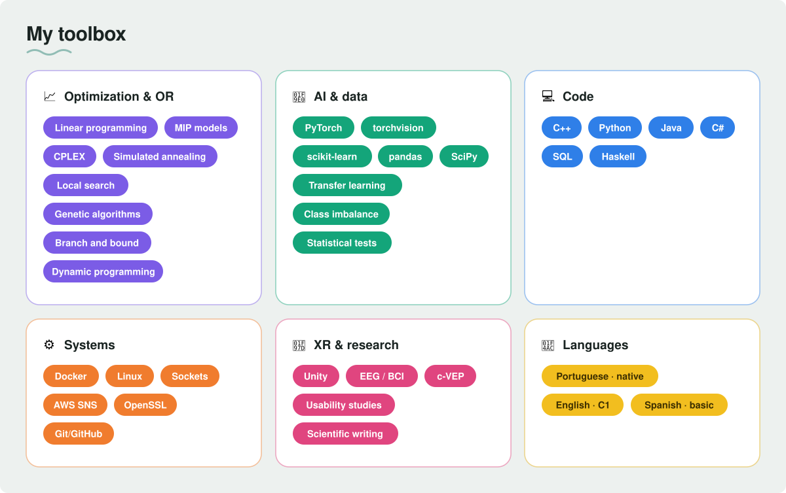

  &nbsp;
  &nbsp;
  

I'm a Computer Science student at **UFOP** (Brazil), **graduating in December 2026**. I started as a chemistry technician at Coltec/UFMG, moved into computing, built a brain-controlled VR simulator at the XR4GOOD Lab, spent a semester in Austria studying logistics and operations research, and I'm closing my degree with a thesis in optimization at the GOAL Lab. What ties it together: taking messy real-world problems and turning them into models a computer can solve.

 

**🇦🇹 Exchange semester at Montanuniversität Leoben, Austria** · Feb–Jul 2026 
Logistics, supply chain, operations research and AI, all in English. Wrote and presented *Optimization Algorithms in Logistics: A Critical Review of Metaheuristic Approaches for Routing and Distribution Problems* and pitched a supply chain bringing açaí from the Amazon to Europe.

 

**🧠 VR + brain–computer interface for the mining industry** · XR4GOOD Lab · 2024–2025 
A VR simulator of ore-wagon loading in Unity/C# where you choose the silo by looking at it: each target flickers in its own binary code and an 8-channel EEG detects which one you're watching. Tested with 26 participants, usability score of 77 (benchmark: 68). 
📄 [ICEIS 2025](https://doi.org/10.5220/0013483800003929) · 📄 [SVR 2025](https://doi.org/10.1109/SVR67689.2025.00046)

 

**🏫 Metaheuristics for classroom allocation** · GOAL Lab · thesis · 2025–2026 
Real institutional data, a mathematical model and C++ metaheuristics that weigh room capacity, preferences and scheduling constraints: greedy/RCL construction, hill climbing over 5 neighbourhoods and a hybrid simulated annealing. 
💻 [code](https://github.com/joao-jardim/tp-metaheuristicas)

 

**👕 Teaching a network to see the rare classes** · PyTorch 
Three FashionMNIST classes cut to 300 images to mimic real-world imbalance. Fine-tuned MobileNetV2 with a hybrid sampler and weighted loss: macro-F1 went from **0.837 to 0.889**.

 

 

### More things I've built

- **[Fleet routing](https://github.com/joao-jardim/TP_otimizacao)** · mixed-integer model minimizing makespan, with truck–forklift synchronization &nbsp;`C++` `CPLEX`
- **[Ore blending](https://github.com/joao-jardim/cplex_cpp)** · minimum-cost ore mixing under iron, silica and alumina targets &nbsp;`C++` `CPLEX`
- **[Two-constraint knapsack](https://github.com/joao-jardim/problema-da-mochila)** · backtracking vs. branch and bound vs. dynamic programming, with a Friedman test &nbsp;`C++` `pandas` `SciPy`
- **[Genetic algorithm for the CVRP](https://github.com/joao-jardim/tp_comp.evolutiva)** · evolutionary approach to capacitated vehicle routing
- **Voting container cluster** · five containers vote over sockets, only the winner writes &nbsp;`Python` `Docker`
- **Cryptography lab image** · RSA key pairs, SHA-256, encryption and decryption &nbsp;`Linux` `OpenSSL`
- **Compiler front end** · lexical, syntactic and semantic analysis &nbsp;`Haskell`
- **Classroom management system** · desktop app with GUI, CRUD and reports, team of 5 &nbsp;`Java`
- **Legacy website rescue** · freelance: staging, DNS, SSL and migration with zero data lost &nbsp;`WordPress` `PHP` `MySQL`
