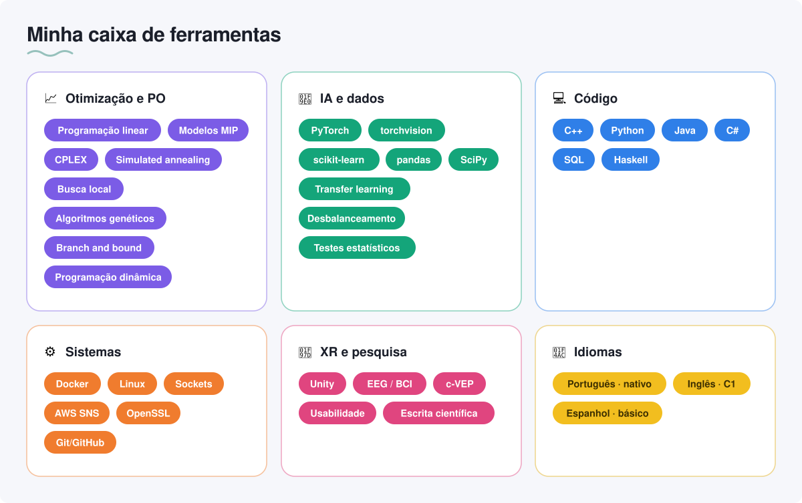

  &nbsp;
  &nbsp;
  

Sou estudante de Ciência da Computação na **UFOP**, com **formatura em dezembro de 2026**. Comecei como técnico em Química no Coltec/UFMG, migrei para a computação, construí um simulador de realidade virtual controlado pelo cérebro no XR4GOOD Lab, passei um semestre na Áustria estudando logística e pesquisa operacional e estou fechando a graduação com um TCC em otimização no GOAL Lab. O fio condutor: pegar problemas reais e bagunçados e transformar em modelos que um computador consegue resolver.

 

**🇦🇹 Intercâmbio na Montanuniversität Leoben, Áustria** · fev–jul 2026 
Logística, supply chain, pesquisa operacional e IA, tudo em inglês. Escrevi e apresentei *Optimization Algorithms in Logistics: A Critical Review of Metaheuristic Approaches for Routing and Distribution Problems* e apresentei um pitch de cadeia de suprimentos levando açaí da Amazônia para a Europa.

 

**🧠 Realidade virtual + interface cérebro-computador para a mineração** · XR4GOOD Lab · 2024–2025 
Um simulador em RV do carregamento de vagões de minério, feito em Unity/C#, em que você escolhe o silo olhando para ele: cada alvo pisca no seu próprio código binário e um EEG de 8 canais detecta qual você está olhando. Testado com 26 participantes, nota de usabilidade 77 (referência: 68). 
📄 [ICEIS 2025](https://doi.org/10.5220/0013483800003929) · 📄 [SVR 2025](https://doi.org/10.1109/SVR67689.2025.00046)

 

**🏫 Metaheurísticas para alocação de salas** · GOAL Lab · TCC · 2025–2026 
Dados reais da instituição, um modelo matemático e metaheurísticas em C++ que consideram capacidade das salas, preferências e restrições de horário: construção gulosa com LRC, hill climbing com 5 vizinhanças e um simulated annealing híbrido. 
💻 [código](https://github.com/joao-jardim/tp-metaheuristicas)

 

**👕 Ensinando uma rede a enxergar as classes raras** · PyTorch 
Três classes do FashionMNIST reduzidas a 300 imagens para imitar o desbalanceamento do mundo real. MobileNetV2 ajustada com amostrador híbrido e perda ponderada: o macro-F1 subiu de **0,837 para 0,889**.

 

 

### Outras coisas que construí

- **[Roteamento de frota](https://github.com/joao-jardim/TP_otimizacao)** · modelo inteiro misto que minimiza o makespan, com sincronização entre caminhões e empilhadeiras &nbsp;`C++` `CPLEX`
- **[Mistura de minérios](https://github.com/joao-jardim/cplex_cpp)** · mistura de custo mínimo com metas de ferro, sílica e alumina &nbsp;`C++` `CPLEX`
- **[Mochila com duas restrições](https://github.com/joao-jardim/problema-da-mochila)** · backtracking vs. branch and bound vs. programação dinâmica, com teste de Friedman &nbsp;`C++` `pandas` `SciPy`
- **[Algoritmo genético para o CVRP](https://github.com/joao-jardim/tp_comp.evolutiva)** · abordagem evolutiva para roteamento de veículos com capacidade
- **Cluster de containers com votação** · cinco containers votam via sockets e só o vencedor escreve &nbsp;`Python` `Docker`
- **Imagem de laboratório de criptografia** · pares de chaves RSA, SHA-256, cifragem e decifragem &nbsp;`Linux` `OpenSSL`
- **Front-end de compilador** · análise léxica, sintática e semântica &nbsp;`Haskell`
- **Sistema de gestão de salas** · app desktop com interface, CRUD e relatórios, equipe de 5 &nbsp;`Java`
- **Resgate de site legado** · freela: staging, DNS, SSL e migração sem perder nenhum dado &nbsp;`WordPress` `PHP` `MySQL`
